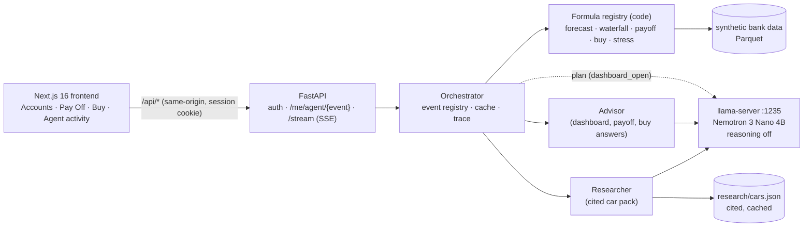

# Guidestone

**A bank dashboard that forecasts your cash, tells you the next move, and shows its work. A small local model plans and explains it; code does every calculation.**

Hackathon tracks: **PNC 360° Financial Health Navigator** · **NVIDIA Nemotron "Beyond a Chatbot"**

> All customer data in this repo is synthetic. No real person's finances are used anywhere.

---

## What it does

| Screen | Route | What the customer sees |
|---|---|---|
| **Accounts** | `/accounts` | Balances, spending (monthly averages), recurring bills, transactions, and a **24-month cash forecast** with an 80% band. The **advisor card** gives a verdict (`On track` / `Plan ahead` / `Act now`) and up to 3 next moves. |
| **Pay Off** | `/simulate/payoff` | Five payoff strategies compared (avalanche, snowball, lump sum, lump sum + avalanche, minimums only): months to debt-free, interest, and what each does to the cash cushion in a bad stretch. A verdict (`Pay it off`, `Pay it off, with a tradeoff`, `Keep your cash`, ...) and a two-sentence answer. |
| **Buy (cars)** | `/simulate/buy` | Pick a segment, budget and priorities. Up to 3 cars from a cited research pack, each figure linked to its source, then three ways to pay (cash / finance / mix) with a verdict (`affordable` / `stretch` / `not_now`). |
| **Agent activity** | panel on each screen | Live steps of the agent run over server-sent events: planning, calculations, rules, writing, checking, retries, template fallback, cache replays. Plain-language labels only. |
| Login | `/login` | Email + shared demo password; in demo mode, "Sign in as ..." buttons for the featured personas. |
| Debug | `/debug` | Internal page for running any registered formula (only when `DEMO_MODE=true`). |

Example, persona **C067** (34, renter, a $14,500 card at 24.84% APR):
- Advisor: **Act now**: "Your card balance of $14,500 costs 24.8% a year in interest, so extra money goes here before other goals."
- Pay Off: minimums only take **342 months** (to 2055) and $28,883 of interest; strategy **D** (safe lump sum of $10,204, then avalanche) is debt-free in **6 months** with $289 of interest, saving $28,594. The tradeoff is stated: in a bad stretch cash dips to about $5,771, under the $10,511 cushion target, for 6 months.

Persona **C095** (46, mortgage at 2.773%, savings earning 4.08%): Pay Off says **Keep your cash**: "Your mortgage costs 2.8% a year, less than the 4.1% your savings earn, so extra payments are optional."

---

## Architecture



**Event-triggered agents, not a chat box.** The customer never types a prompt. Opening a screen or pressing a button fires an event (`dashboard_open`, `simulate_payoff`, `simulate_buy`). For each event the registry fixes what is always computed, which extra tools the planner may add, and how the result is cached. The model's jobs are narrow: choose extra calculations (dashboard), rank and pick from code-generated options, and word the explanation. Results are cached per session and parameters, and the stream endpoint replays cached steps or joins a run already in flight.

### The agents

| Agent | Role | Model & settings | Inputs | Outputs | Guardrails |
|---|---|---|---|---|---|
| **Orchestrator** (planner) | For `dashboard_open`, chooses extra calculations (e.g. `job_loss_stress`) on top of the precomputed forecast | Nemotron 3 Nano 4B, reasoning off, temp 0.0, ≤200 tokens | Status labels only (cushion status, trend, overdraft status, paycheck-to-paycheck, employment) + tool list | `{"steps":[{tool,args,reason}]}`, ≤4 steps | Tools bound to the session's customer; allowlist per event; args validated against slim schemas; duplicates rejected; any failure → default plan decided in code |
| **Advisor** (dashboard) | Picks and orders up to 3 next moves from the candidate list and writes title + why | Nemotron 3 Nano 4B, reasoning off, temp 0.3; 12 s budget | Waterfall, candidate moves with their facts as placeholders, forecast labels | `move_code`s (schema enum) + text with `{placeholders}` | Verdict set in code; unknown move code rejected; grounding + judgment + style checks; one retry, then template |
| **Advisor** (payoff / buy answer) | Two plain sentences about the chosen strategy or way to pay | same | The chosen plan's figures as placeholders; "be sure to mention" points (warnings) | One `answer` string | Must mention every warning; no yes/no or judgment; grounding; one retry, then template |
| **Researcher** | Picks up to 3 cars that fit the query and writes one sentence each | Nemotron 3 Nano 4B, reasoning off, temp 0.2 | Only the sanitized `BuyQuery` (segment, budget band, priorities) and the matching pack entries. No profile field, no APR | Car `id`s (schema enum of eligible ids) + one sentence with `{placeholders}` | Every figure must be in that car's own record; one retry, then a code score on the priorities + template sentence |

All agents use the same OpenAI-compatible client: `<think>` blocks are stripped and never logged, bad JSON is retried once, a dead server raises `LLMUnavailable` and the caller falls back. Per-agent backend, model, temperature, timeout and reasoning are configurable by env var. A `presenter` agent slot exists in the config but no Presenter is built.

**What the model does and doesn't do.** Nemotron plans, ranks and explains. Code does all the math, sets every verdict, and generates the only options the model may choose from. The model writes `{placeholders}`, never numbers; the app fills them in, then a grounding check confirms every figure in the final text matches a fact (with the words around it agreeing with the fact's meaning). If the check fails twice, the customer gets a deterministic template built only from the facts. Measured with `scripts/advisor_latency.py`: reasoning off answers in about 4 s (p90 6 s) with the same first-try pass rate as reasoning on (about 15 s, p90 25 s), so reasoning is off by default.

---

## Cash forecast

`backend/app/formulas/forecast.py`, full write-up in [docs/forecast.md](docs/forecast.md).

- **Schedule (deterministic):** recurring paychecks, bills and loan payments detected from 24 months of history, placed on real business days; raises, rent renewals, Social Security COLA, inflation; loans end on schedule.
- **Variable spend (Monte Carlo, 1,000 paths):** block bootstrap of the customer's own months (2–3 month runs), seasonality, parameter uncertainty, drift, simulated card balances, noisy bills, learned sweep rules.
- **Calibration:** split-conformal scaling per horizon (30/90/180 days), separate factors for the daily and monthly charts; bands never narrow.
- **Outputs:** p10/p50/p90 daily and monthly, `overdraft_risk` (below $0), `cushion_risk` (below one month of essentials), low point, events (extra paychecks, loan endings, raises).
- About 18 ms for a 24-month, 1,000-path forecast (median over customers).

**Accuracy** (backtest: train on 18 months, forecast the last 6, 98 customers, scored on held-out customers):

> On customers the model had never seen, the 80% band contained the actual outcome **82%** of the time at month-end (**84%** of days). The typical customer's six-month error is about **6.2%** of one month's spending.

| Horizon | Median error | 75th pct | 90th pct |
|---|---|---|---|
| 30 days | 3.9% | 6.8% | 14.8% |
| 90 days | 5.8% | 8.1% | 10.9% |
| 180 days | 6.2% | 10.8% | 17.1% |

Error is the stricter of two measures, as a share of the customer's monthly outflow. Raw (uncalibrated) coverage was 60% month-end / 43% daily. Risk: of 87 customers forecast under 10% to fall below a cushion, none did; of 6 forecast at 60%+, all 6 did. This shows discrimination, not fine calibration (only 7 cushion events). Held-out customers share the same test months, so this validates across customers, not across time.

---

## Decision rules

Deterministic, registered formulas; thresholds in `backend/app/assumptions.json`. Full spec: [docs/rules.md](docs/rules.md).

- **Priority waterfall** (where free surplus goes): 1 starter fund ($1,000) → 2 employer 401(k) match → 3 debt ≥ 8% APR, highest first → 4 full emergency fund (3 months of essentials, 6 if paycheck-to-paycheck or dependents) → 5 retirement toward 15% of gross → 6 education → 7 moderate-APR debt or extra investing. Retirement always before education.
- **Payoff priority:** a lump sum never takes cash below 3 months of essentials (1 month for cards ≥ 20% APR, flagged as a tradeoff); avalanche order, cards before loans at equal APR; debt cheaper than the safe savings rate gets `keep_cash_earns_more`; mortgage excluded unless > 6.5% and steps 1–5 are done; freed payments roll over.
- **Candidate moves:** 14 move codes, each generated by code only when its condition holds. These are the only moves the advisor may recommend.
- **Verdicts (code):** dashboard `act_now` if the current step is 1 or 3 or status is at-risk; `plan_ahead` for steps 4–6 or watch; else `on_track`. Buy: `affordable` if the payment is ≤ 10% of gross monthly income **and** the cushion holds in the bad-luck forecast; `stretch` if one fails; `not_now` if both fail.

---

## Privacy and security

- **Session-bound tools.** The customer is whoever the session cookie says. Agent endpoints are `/api/me/...`; no endpoint takes a customer id, and every formula given to a model is bound to that one profile. The model never chooses whose data it reads.
- **The sanitizer.** The Researcher receives an allowlisted `BuyQuery`: segment, budget **rounded down to a $5,000 band**, and priorities. Every other key is dropped. No name, balance, income or credit score reaches it; the auto-loan APR is looked up in code afterwards.
- **No customer data or prompts in traces or streams.** Run traces hold tool names, codes, timings and counts. Stream events use a fixed label catalog with a closed `detail` shape (extra keys rejected). Model reasoning is stripped and never logged.
- **Local inference.** All model calls go to llama-server on localhost. A `hosted` backend option exists in config but is not implemented.
- **Auth.** One shared demo password, stored only as an argon2 hash (`DEMO_PASSWORD_HASH`); httpOnly SameSite=Lax signed session cookie; server-side session list so sign-out really ends a session; login rate limiting; the same error for an unknown email and a wrong password.
- **Secrets.** `.env` is gitignored; only `.env.example` (names, no values) is committed. Demo emails use the reserved `example.com` domain.

---

## Data

- **Synthetic bank data** from `scripts/generate_bank_data.py` (deterministic, seed `20261107`): 100 customers, 24 months of transactions, checking/savings/cards/loans/CDs/IRAs/mortgages. The ledger reconciles exactly. Side generators add bio fields (state, dependents, 401(k)), estimated home and vehicle values, and demo logins.
- **Validation:** typed Parquet schema (decimal money, explicit types), a loader that collects every validation error and fails at boot, and check scripts (`check_derive.py`: expense identity within 0.11%, cash-flow tie-out within 0.06% of income; `check_forecast.py`: model and calibration still match).
- **Assumptions with sources** (`assumptions.json`): inflation 3.15%, wage growth 3.1% (BLS ECI), SS COLA 3.6% (SSA), rent renewal 2.8% (BLS), job-loss and re-employment rates (BLS CPS), PA unemployment benefits; each with URL and date.
- **Research pack** (`backend/app/research/cars.json`, fetched 2026-11-08): 6 cars (3 compact SUVs, 3 midsize sedans) and auto-loan APRs by credit tier. Sources: manufacturer newsrooms and pages (MSRP), FuelEconomy.gov / EPA (MPG), NHTSA Safety Ratings API (stars), IIHS Top Safety Picks (awards), Bankrate's table of Experian Q2 2026 data (APR). Every figure has a URL and a copied snippet. **When a source couldn't be fetched, the value is `null` with the reason, never filled from memory** (6 of the 24 vehicle figures are null, e.g. toyota.com returned 403). A car with no cited price is never offered.

---

## Tech stack

| Layer | Tech |
|---|---|
| Model | NVIDIA Nemotron 3 Nano 4B on llama.cpp `llama-server` (OpenAI-compatible API) |
| Backend | Python 3.14, FastAPI, Uvicorn, Pydantic, OpenAI Python SDK, httpx, pandas, PyArrow, argon2-cffi, PyJWT |
| Frontend | Next.js 16, React 19, TypeScript, Tailwind CSS 4, Recharts, types generated by openapi-typescript |
| Tests | pytest (mock LLM transport) |

---

## How to run

**1. Model server.** Start llama.cpp's `llama-server` with a Nemotron 3 Nano 4B GGUF on port 1235, served under the name the backend asks for, with reasoning turned off:

```bash
llama-server -m /path/to/nemotron-3-nano-4b.gguf --alias nemotron-nano-4b-nothink --port 1235
```

(The model path is yours to set. Configure the server so the model doesn't reason; the backend also sends `/no_think`.)

**2. Backend** (from the repo root):

```bash
python3 -m venv .venv && .venv/bin/pip install -r requirements.txt
cp .env.example .env                                   # then fill it in
.venv/bin/python3 scripts/hash_password.py --secret    # -> SESSION_SECRET
.venv/bin/python3 scripts/hash_password.py 'pick-a-password'   # -> DEMO_PASSWORD_HASH
cd backend && ../.venv/bin/python3 -m uvicorn app.main:app --reload    # http://localhost:8000/docs
```

The data files are gitignored. To regenerate them, run in order: `generate_bank_data.py`, `to_parquet.py`, `generate_bio.py`, `generate_assets.py`, `gen_users.py` (all in `scripts/`).

**3. Frontend:**

```bash
cd frontend && npm install && npm run dev               # http://localhost:3000
```

**Environment variables** (names only; see `.env.example`):
- Backend: `SESSION_SECRET`, `DEMO_PASSWORD_HASH`, `DEMO_MODE`, `COOKIE_SECURE`, `SESSION_HOURS`, `FRONTEND_ORIGIN`, `ADVISOR_BUDGET_S`, `LLM_BASE_URL`, `LLM_API_KEY`, and per agent `LLM_<AGENT>_{BACKEND,BASE_URL,MODEL,REASONING,TIMEOUT,TEMPERATURE,MAX_TOKENS}`
- Frontend (`frontend/.env.local`): `API_ORIGIN`, `DEMO_MODE`, `DEMO_PASSWORD_HINT`

**Demo login:** with `DEMO_MODE=true`, the login page shows "Sign in as ..." for the featured personas C002, C067, C095, C010, C059. Otherwise sign in as `c067@example.com` (any `cNNN@example.com`) with the demo password you hashed.

---

## Testing

```bash
cd backend && ../.venv/bin/python3 -m pytest -q
```

**426 passed** (about 20 s). The LLM is replaced by a mock transport, so tests are deterministic and don't need a model server. Covered:

- API and auth: endpoints, strict JSON for every formula, sessions, sign-out, rate limits, a customer can't read another's data
- Grounding: figure extraction, keyword agreement, judgment and style checks, retry and template fallback
- LLM client: retries, error classes, reasoning stripping, schema enforcement
- Orchestrator and stream: plan validation, default plans, timeouts, caching, replay, joining a run in flight, no customer data in events
- Rules and advisor: the five golden personas' waterfall steps, candidate moves, verdicts, pinned moves
- Debt, payoff and simulation: amortization, strategies A–F, warnings, cushion measures
- Buy: sanitizer, research pack integrity, buy plans and verdicts, the `simulate_buy` event

Plus check scripts in `scripts/` (`check_derive.py`, `check_forecast.py`, `payoff_check.py`, `advisor_check.py`, `agent_check.py`, `llm_smoke.py`).

---

## Limitations and future work

- **Synthetic data.** Methods don't depend on the generator; some numbers might.
- **Research is a cited, cached pack, not live search.** 6 cars, fetched once.
- **Local inference only.** A hosted fallback and a data minimizer for it are designed, not built.
- **Next Steps:** a Presenter agent; a Plan screen (retirement, education); Buy for homes.
- **Forecast:** calibration covers 6 months (held flat beyond); validated across customers, not across time; no within-month transaction timing (the daily band's ~x8 factor stands in for it); three what-if types return 501.
- Car prices are starting MSRP before tax, destination and fees.
- The PA unemployment weekly cap ($604) comes from an undated chart and is unconfirmed.
